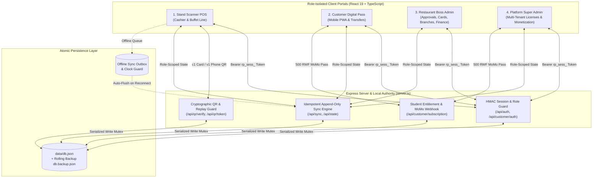

# RestoPass — Multi-Tenant Campus & Cafeteria Meal Pass Authority

[](https://github.com/ephremdushime/restourant/actions/workflows/ci.yml)


**RestoPass** is an offline-resilient, cryptographically verifiable prepaid meal-card and digital pass platform built for university cafeterias, high-volume campus dining halls, and multi-branch restaurants in Rwanda (`RWF`).

It replaces paper meal tickets, fragile manual spreadsheets, and screenshot-vulnerable QR codes with a **4-portal role-isolated architecture**, an **append-only financial ledger**, **dual-mode QR credentials** (CR80 physical PVC cards + 30-second rotating phone passes), and **delegated Mobile Money (`MTN MoMo` / `Airtel Money`) approval workflows**.

---

## Table of Contents

1. [System Architecture & Core Design Principles](#1-system-architecture--core-design-principles)
2. [The Four Role-Isolated Portals](#2-the-four-role-isolated-portals)
3. [Cryptographic QR & Physical PVC Card Engine](#3-cryptographic-qr--physical-pvc-card-engine)
4. [Scanner Station Validation & Sound Alert Specification](#4-scanner-station-validation--sound-alert-specification)
5. [Subscription Top-Ups, Boss Approval Room & 3-Grace-Meal Policy](#5-subscription-top-ups-boss-approval-room--3-grace-meal-policy)
6. [Non-SMS Customer Authentication, Activation & PIN Recovery](#6-non-sms-customer-authentication-activation--pin-recovery)
7. [Student Digital Pass Monetization (500 RWF/Month Feature Flag)](#7-student-digital-pass-monetization-500-rwfmonth-feature-flag)
8. [Project Structure](#8-project-structure)
9. [Getting Started & Local Development](#9-getting-started--local-development)
10. [Production Environment & Security Configuration](#10-production-environment--security-configuration)
11. [API Reference](#11-api-reference)
12. [Automated Quality Gate & Test Suite](#12-automated-quality-gate--test-suite)

---

## 1. System Architecture & Core Design Principles



### Key Architectural Guarantees
- **Append-Only Financial Ledger**: Meal balances are never mutated via raw counters. Every balance is computed deterministically from the latest `BalanceCheckpoint` plus the sum of subsequent `LedgerEntry` records (`purchase`, `scan`, `extra`, `undo`, `transfer_out`, `transfer_in`, `adjustment`, `reversal`), protected by `idempotencyKey` guards.
- **Strict Tenant & Customer Isolation**:
  - `super_admin` governs global restaurant onboarding, signed licenses, and platform-wide monetization settings.
  - `restaurant_admin` and `stand_staff` are scoped strictly to their authenticated `restaurantCode`.
  - `customer` sessions are isolated to the single authenticated patron (`user.userId`) and never fall back to another customer record on the same device.
- **Anti-Rollback Clock Guard**: Every restaurant tracks `highestTimeSeen`. Rolling a device clock backward cannot extend an expired license or bypass the 2-hour meal window.
- **Multilingual Support**: Built-in localization for **English (`en`)**, **Kinyarwanda (`rw`)**, and **French (`fr`)**.

---

## 2. The Four Role-Isolated Portals

### 2.1 Stand Scanner Station (`stand_staff`)
- **Hardware & Camera Scanning**: Supports USB/Bluetooth HID barcode guns (auto-focused wedge input), GPU-accelerated browser `BarcodeDetector` camera scanning, and manual Member ID lookup.
- **Rogue Wi-Fi Terminal Shield**: Only devices paired with a valid station pairing key (`PAIR-XXXX`) and active `CashierSession` can access the scanning screen.
- **Reception Provisional Desk**: When the restaurant boss is away, cashiers can register new patrons or submit balance top-ups with Mobile Money transaction references, granting up to **3 authorized grace meals** while awaiting boss verification.
- **In-Person PIN & Activation Desk**: Issues 15-minute, single-use 6-digit activation and PIN-recovery codes after verifying a patron's physical Student ID or National ID.
- **Shift Handover & Cash Reconciliation**: Tracks opening float, cash collected, plates served, and variance upon shift closure.

### 2.2 Customer Meal Pass Portal (`customer`)
- **Live Rotating Digital QR (`v1`)**: Generates a 30-second time-stepped HMAC token with a live countdown ring and anti-screenshot protection.
- **Real-Time Balance & Ledger History**: Displays current meal balance, low-balance alerts (`< 5` plates), and an itemized history of buffet scans, top-ups, and transfers.
- **PIN-Protected Peer-to-Peer Plate Transfers**: Patrons can transfer prepaid plates to another member in the same restaurant using their 6+ digit personal security PIN.
- **Self-Service Card Lock**: Patrons can immediately lock/unlock their physical PVC card if misplaced.

### 2.3 Restaurant Boss / Administrator Portal (`restaurant_admin`)
- **Boss MoMo Approval Room**: Central queue to inspect pending registrations and top-ups against MTN MoMo / Airtel Money SMS statements, reconcile grace meals automatically, and dispatch 1-tap WhatsApp pass links.
- **CR80 Physical PVC Card Print Studio**: Duplex (`85.60mm × 53.98mm`) front-and-back badge designer and print studio with Kinyarwanda/English property notices.
- **Executive Monthly Reconciliation**: Tracks monthly prepaid plates & cash intake, used plates & cash value, and remaining patron liability.
- **Branches, Stations & Security Center**: Manage multiple dining halls, create 8-digit PIN/password cashier accounts, inspect audit logs, and remotely revoke active cashier terminal sessions.
- **Menu, Packages & Notifications Studio**: Configure meal bundles (`10`, `15`, `30`, `60` plates), single-plate baseline pricing, and targeted or broadcast in-app notifications.

### 2.4 Platform Super Admin Portal (`super_admin`)
- **Restaurant Onboarding & Licensing**: Onboard new restaurants, configure plan terms (`Campus Stand Starter`, `High-Volume Multi-Stand`), and issue cryptographically signed licenses with grace periods and scan-point caps.
- **Student Subscription Monetization Control**: Toggle the `500 RWF/month` student digital subscription policy, view platform-wide subscription revenue, and grant or revoke audited complimentary entitlements.

---

## 3. Cryptographic QR & Physical PVC Card Engine

RestoPass supports two cryptographically signed QR protocols derived hierarchically from `RESTOPASS_MASTER_SECRET`:

$$\text{RestaurantKey} = \text{HMAC-SHA256}(\text{MasterSecret},\ \text{"RESTAURANT:"} \parallel \text{restaurantCode})$$

| Credential Type | Token Format | Replay & Revocation Mechanism | Spot-Check Policy |
| :--- | :--- | :--- | :--- |
| **Physical PVC Card (`c1`)** | `c1.<RESTO>.<MEMBER_NO>.<CARD_VER>.<MAC16>` | Bound to `cardVersion` and `cardStatus`. Reissuing a card increments `cardVersion`, immediately invalidating the lost/old plastic badge even offline. | Always triggers a staff photo verification prompt on the scanner screen. |
| **Dynamic Phone QR (`v1`)** | `v1.<RESTO>.<MEMBER_NO>.<STEP_30S>.<MAC16>` | Bound to `keyVersion` and 30-second time step (`floor(now / 30000)`). Single-use step tracking (`usedTokens`) blocks screenshot sharing across all terminals. | Triggers random spot-checks (e.g. 10%) and repeat-in-window photo checks. |

### CR80 Physical Card Printing Specifications
- **Standard Dimensions**: ISO/IEC 7810 ID-1 (`85.60mm × 53.98mm`, aspect ratio ~`1.586`).
- **Front Side**: Restaurant branding, patron photo, full name, Member ID (`#28491`), serial number (`RP202628491`), and high-contrast `c1` QR code. **Dynamic meal balances are never printed on the physical card.**
- **Back Side**: Bilingual ownership & return notice in Kinyarwanda (*"Iyi karita ni umutungo wa resitora..."*) and English (*"This card is the property of the restaurant..."*).
- **Print Stylesheet**: Dedicated `@media print` and `@page { size: 85.60mm 53.98mm; margin: 0; }` rules in [`src/index.css`](file:///c:/Users/ADMIN/Restourant/restourant/src/index.css) ensure exact duplex page breaks for Front Only, Back Only, or Double-Sided (`Front -> Page Break -> Back`) printing.

---

## 4. Scanner Station Validation & Sound Alert Specification

Every scan at the buffet stand executes **6 ordered validation rules** in [`restoStore.processScan()`](file:///c:/Users/ADMIN/Restourant/restourant/src/store/restoStore.ts) and emits one of two unmistakable Web Audio synthesizer tones via [`audioService.ts`](file:///c:/Users/ADMIN/Restourant/restourant/src/services/audioService.ts):

- **Sound 1 (`playSuccessSound`)**: One short, bright confirmation tone (`1850Hz -> 2150Hz`) played **only** after a meal deduction or authorized grace meal is committed. Identical for physical cards and phone QR passes.
- **Sound 2 (`playFailureSound`)**: One distinct, lower-pitched double warning tone (`260Hz -> 195Hz` sawtooth) played **once** whenever a scan is rejected.

### Ordered Scan Decision Table

| Step | Validation Check | Outcome if Failed | Sound Played | Cashier Screen Message |
| :---: | :--- | :---: | :---: | :--- |
| **1** | **QR Validation**: Token format, restaurant code, cryptographic MAC, time-step expiry, and replay check | `REJECTED` (`INVALID_QR`) | Sound 2 (Warning) | `"Invalid card / QR code — <reason>"` |
| **2** | **Account Eligibility**: Card not locked, account not suspended or rejected | `REJECTED` (`ACCOUNT_INACTIVE`) | Sound 2 (Warning) | `"Account not active — <reason>"` |
| **3** | **Available Credits**: Approved balance $\ge 1$, OR balance is $0$ with an eligible pending payment ($< 3$ grace meals used) | `REJECTED` (`NO_BALANCE`) | Sound 2 (Warning) | `"No balance — please top up or await payment approval."` |
| **4** | **Successive Scans (Anti-Passback)**: Same customer cannot scan twice consecutively at the same station unless another customer's **accepted** scan occurs in between *(failed scans do not reset this check)* | `REJECTED` (`CONSECUTIVE_SCAN`) | Sound 2 (Warning) | `"Too many successive taps — scan another customer first."` |
| **5** | **Two-Hour Limit**: Customer has consumed fewer than **3 meals** in the rolling **120-minute** window *(counts only accepted paid + grace meals)* | `REJECTED` (`TWO_HOUR_LIMIT`) | Sound 2 (Warning) | `"Meal limit reached — maximum 3 meals in 2 hours."` |
| **6** | **Commit Meal**: Deducts `1` paid credit (or records `1` grace meal if balance is `0` and eligible) | `ACCEPTED` | Sound 1 (Success) | `"Meal accepted — 1 meal recorded."` |

---

## 5. Subscription Top-Ups, Boss Approval Room & 3-Grace-Meal Policy

RestoPass separates **customer account status** from **individual transaction approval status** so that pending top-ups never disrupt an active patron's existing paid balance.

| Scenario | System Behavior | Final Balance After Boss Approval |
| :--- | :--- | :--- |
| **Existing balance: `103` · Customer pays for `60` more** | Customer stays active; usable balance remains `103` while top-up is in the Boss Approval Room. | **`163`** (`103 + 60`) |
| **Existing balance: `5` · Customer pays for `60` more** | Customer uses their remaining `5` paid credits first (`0` grace meals counted). If `2` meals are eaten while pending, balance becomes `3`. | **`63`** (`3 + 60` — no double-charging) |
| **Existing balance: `0` · Customer pays for `60` more** | Payment enters Boss Approval Room. Customer can consume up to **3 authorized grace meals** while waiting. | **`60 - graceMealsConsumed`** (e.g. `58` if `2` grace meals used) |
| **New customer registers & pays for `60`** | Registration + payment enter Boss Approval Room. Customer can consume up to **3 grace meals** immediately. | **`60 - graceMealsConsumed`** (e.g. `57` if `3` grace meals used); account & card activate |
| **Balance is `0` & `3` grace meals already used** | No further grace meals are authorized until the Boss approves the pending payment (submitting a second pending top-up does **not** reset the grace counter). | Reconciled atomically per approved transaction |

---

## 6. Non-SMS Customer Authentication, Activation & PIN Recovery

Because campus environments cannot rely on paid SMS OTP delivery for every login, RestoPass implements a **zero-SMS, in-person verified PIN lifecycle**:

1. **Registration & Boss Approval**: Cashier registers the patron; Boss confirms the Mobile Money deposit (`activationStatus: 'ready_for_activation'`).
2. **In-Person Activation Code (`15 minutes`, Single-Use)**: At the cafeteria desk, staff verify the patron's physical Student/National ID and generate a 6-digit activation code (`requestCustomerActivation`).
3. **Private Customer PIN Setup (`6+ digits`)**: The patron enters their phone number, the 6-digit activation code, and chooses their own **6+ digit numeric PIN** (`completeCustomerActivation`). Staff never choose or see the customer's PIN.
4. **Phone + PIN Login with Anti-Enumeration & Lockout**:
   - Patrons sign in using their registered phone number and 6+ digit PIN (`/api/customer/auth/login`).
   - Returns a generic `"Invalid phone number or PIN"` on failure to prevent phone-number enumeration.
   - Temporarily locks the account for **15 minutes** after **5 consecutive failed attempts**.
5. **Audited PIN Recovery**: If a patron forgets their PIN, staff verify their physical ID and log a recovery request (`requestCustomerPinRecovery`), which a manager approves to issue a single-use reset code (`approveCustomerPinRecovery`). Completing recovery increments `keyVersion`, revoking all prior sessions.

---

## 7. Student Digital Pass Monetization (500 RWF/Month Feature Flag)

RestoPass includes a built-in, super-admin-controlled monetization engine for student digital features (`customer_dashboard`, `digital_plate_transfer`):

- **Disabled by Default at Launch (`enabled: false`)**: All digital features work without restriction until the platform founder explicitly enables the policy.
- **Integer-Safe Pricing (`500 RWF` / 30 Days)**: When enabled, students can subscribe via MTN Mobile Money (`*182#`) or Airtel Money (`*500#`) for exactly **500 RWF/month**, with an automatic **72-hour (3-day) grace period** after expiration.
- **100% Physical Card Fallback Guarantee**: Even when a student's digital subscription is unsubscribed or expired, their **physical PVC card (`c1`) continues to scan and redeem prepaid meals at all buffet stands without interruption**.
- **Audited Complimentary Access**: Super Admins can grant or revoke complimentary passes with a mandatory audit reason.

---

## 8. Project Structure

```text
restourant/
├── .github/workflows/
│   └── ci.yml                          # GitHub Actions CI: Node 22 typecheck, test suite, and Vite build
├── data/
│   └── db.json                         # Server-authoritative state (auto-created with atomic write + backup)
├── src/
│   ├── components/
│   │   ├── common/                     # Header, AuthPortalView, QrCanvas, NotificationDrawer, BatteryIndicator
│   │   ├── customer/                   # CustomerView, PinSetupModal, DashboardLockScreen, PWAInstallBanner
│   │   ├── restaurant/                 # RestaurantAdminView, BossApprovalsManager, CardPrintStudio,
│   │   │                               # BranchesAndStationsManager, RestaurantSecurityCenter, PricingAnalytics
│   │   ├── scanner/                    # ScannerView, ScannerProvisionalModal, ShiftHandoverModal,
│   │   │                               # TerminalPairingModal, UnauthorizedTerminalShield
│   │   ├── superadmin/                 # SuperAdminView, DeploymentBlueprintView
│   │   └── sync/                       # SyncSimulationDrawer
│   ├── services/
│   │   ├── audioService.ts             # Web Audio API scanner sound synthesizer (Sound 1 & Sound 2 + unlock)
│   │   ├── cryptoService.ts            # HMAC-SHA256 key derivation, QR signing/verification, salted PIN hashing
│   │   ├── exportService.ts            # CSV & JSON financial/audit export utilities
│   │   ├── i18n.ts                     # English, Kinyarwanda, and French translations
│   │   ├── magicAuthService.ts         # Tamper-evident v2 WhatsApp magic-link tokens (48h, single-use)
│   │   └── pricingAnalyticsService.ts  # Menu margin & bundle pricing analytics
│   ├── store/
│   │   └── restoStore.ts               # Local authority state machine, ledger engine & server sync client
│   ├── types/
│   │   └── index.ts                    # Strict TypeScript domain models
│   ├── App.tsx                         # Portal router, role session guard & layout shell
│   ├── index.css                       # Tailwind v4 styles + CR80 physical card @media print rules
│   └── main.tsx                        # Application entry point
├── tests/
│   ├── apiSecurity.test.ts             # Session signing, role scoping, customer isolation & prod secret checks
│   ├── cryptoService.test.ts           # SHA-256, HMAC, hierarchical keys, PIN salting & QR verification tests
│   ├── customerAuthAndPhysicalCard.test.ts # Non-SMS PIN lifecycle, CR80 card specs & 500 RWF fallback tests
│   ├── ledgerIntegrity.test.ts         # Append-only ledger & checkpoint calculation tests
│   ├── magicAuth.test.ts               # WhatsApp magic-link HMAC, expiry & single-use replay tests
│   ├── productionRemediation.test.ts   # Station pairing lockout, idempotency, serialized DB saves & QR replay
│   ├── studentSubscription.test.ts     # 500 RWF student monetization, 72h grace & MoMo callback idempotency
│   └── topupGraceAndScannerSpec.test.ts # 5 top-up/grace ledger scenarios & 12 scanner station acceptance tests
├── .env.example                        # Template for production secrets & environment variables
├── package.json                        # Scripts & dependencies
├── server.ts                           # Express API server, auth middleware, QR authority & atomic persistence
├── tsconfig.json                       # TypeScript configuration
└── vite.config.ts                      # Vite 8 bundler configuration
```

---

## 9. Getting Started & Local Development

### Prerequisites
- **Node.js**: `v22.x` or higher recommended
- **npm**: `v10.x` or higher

### 1. Clone & Install Dependencies
```bash
git clone https://github.com/ephremdushime/restourant.git
cd restourant
npm install
```

### 2. Configure Environment Variables
Copy [`.env.example`](file:///c:/Users/ADMIN/Restourant/restourant/.env.example) to `.env`:
```bash
cp .env.example .env
```

### 3. Run the Full-Stack Development Server
```bash
npm run dev
```
This launches the Express authority server and Vite middleware together on **`http://localhost:3000`**.

### 4. Available NPM Scripts

| Command | Description |
| :--- | :--- |
| `npm run dev` | Starts the Express + Vite full-stack server in development mode (`http://localhost:3000`). |
| `npm run build` | Builds the optimized production frontend bundle into `dist/`. |
| `npm start` | Runs the Express authority server (`server.ts`), serving API routes and static assets from `dist/`. |
| `npm run lint` | Runs strict TypeScript type-checking (`tsc --noEmit`). |
| `npm test` | Executes the complete Node.js automated test suite (`62` tests across `8` test files). |

---

## 10. Production Environment & Security Configuration

> [!IMPORTANT]
> In `NODE_ENV=production`, [`server.ts`](file:///c:/Users/ADMIN/Restourant/restourant/server.ts) enforces `validateProductionSecrets()` at startup and **will refuse to boot** if `SESSION_SECRET` or `RESTOPASS_MASTER_SECRET` is missing, shorter than 32 characters, or set to a development default.

### Required Production Variables (`.env`)

```dotenv
NODE_ENV=production
PORT=3000

# Mandatory (>= 32 random characters): Signs and verifies rp_sess_ session tokens
SESSION_SECRET="generate_a_strong_64_hex_char_secret_here_for_session_signing"

# Mandatory (>= 32 random characters): Root HMAC secret for restaurant keys, c1 PVC cards, and v1 phone QRs
RESTOPASS_MASTER_SECRET="generate_a_strong_64_hex_char_secret_here_for_master_authority"
VITE_RESTOPASS_MASTER_KEY="generate_a_strong_64_hex_char_secret_here_for_master_authority"

# Optional role password overrides
RESTOPASS_SUPERADMIN_PASSWORD="your_strong_superadmin_password"
RESTOPASS_BOSS_PASSWORD="your_strong_restaurant_boss_password"
RESTOPASS_STAFF_DEFAULT_PIN="1234"
```

Generate cryptographically strong secrets using Node.js:
```bash
node -e "console.log(require('crypto').randomBytes(32).toString('hex'))"
```

---

## 11. API Reference

| Method & Endpoint | Auth / Roles | Purpose |
| :--- | :--- | :--- |
| `GET /api/health` | Public | Server liveness, uptime, and database state readiness check. |
| `GET /api/public/restaurants` | Public | Safe list of active restaurants (`code`, `name`, `address`, `status`) for portal sign-in. |
| `POST /api/auth/login` | Public (Rate-limited) | Authenticates `super_admin`, `restaurant_admin`, `stand_staff`, or `customer` and issues `rp_sess_` token. |
| `POST /api/customer/auth/login` | Public (Rate-limited) | Customer Phone + 6+ digit PIN login with 5-attempt lockout and anti-enumeration. |
| `POST /api/customer/activation/request` | `stand_staff`, `restaurant_admin`, `super_admin` | Issues a 15-minute single-use 6-digit customer activation code after physical ID check. |
| `POST /api/customer/activation/complete` | Public (Rate-limited) | Verifies activation code and sets customer's salted 6+ digit personal PIN. |
| `POST /api/customer/recovery/request` | Staff / Public | Creates an audited PIN recovery request following physical ID verification. |
| `POST /api/customer/recovery/approve` | `restaurant_admin`, `super_admin` | Approves PIN recovery request and issues a 15-minute single-use reset code. |
| `POST /api/customer/recovery/complete` | Public (Rate-limited) | Resets customer PIN and increments `keyVersion` to revoke prior sessions. |
| `POST /api/qr/token/phone` | Authenticated | Generates an authoritative 30-second `v1` phone QR token for the caller's scope. |
| `POST /api/qr/token/card` | `restaurant_admin`, `super_admin` | Generates an authoritative `c1` physical PVC card QR token. |
| `POST /api/qr/verify` | `stand_staff`, `restaurant_admin`, `super_admin` | Verifies `c1` or `v1` QR tokens with persistent cross-terminal replay protection (`usedTokens`). |
| `POST /api/station/pair` | Public (Brute-force locked) | Pairs a scanner terminal using a valid `PAIR-XXXX` station key and opens a `CashierSession`. |
| `POST /api/station/revoke` | `restaurant_admin`, `super_admin` | Remotely revokes a station's pairing and closes active cashier sessions. |
| `GET /api/state` | Authenticated | Returns role-scoped application state (`customer` receives only their own record & ledger). |
| `POST /api/sync` | Authenticated | Merges client outbox & state changes with strict role guards and ledger `idempotencyKey` deduplication. |
| `GET /api/customer/subscription` | Authenticated | Checks student digital subscription status and entitlement (`500 RWF/month`). |
| `POST /api/customer/subscription/checkout` | `customer` | Initiates an integer-safe `500 RWF` MTN MoMo / Airtel Money subscription payment. |
| `POST /api/payments/mobile-money/callback` | Webhook | Processes Mobile Money provider callbacks idempotently and activates 30-day + 72h grace access. |

---

## 12. Automated Quality Gate & Test Suite

Every push and pull request to `main` is verified by GitHub Actions ([`.github/workflows/ci.yml`](file:///c:/Users/ADMIN/Restourant/restourant/.github/workflows/ci.yml)):

```bash
npm run lint
npm test -- --run
npm run build
```

### Test Coverage Breakdown (`62` Passing Tests)
- **[`tests/apiSecurity.test.ts`](file:///c:/Users/ADMIN/Restourant/restourant/tests/apiSecurity.test.ts)**: HMAC session token signing, tampering/expiration rejection, role-based tenant scoping, atomic DB backup persistence, customer identity isolation (`getCurrentCustomer` never falls back to another customer), and production secret validation.
- **[`tests/cryptoService.test.ts`](file:///c:/Users/ADMIN/Restourant/restourant/tests/cryptoService.test.ts)**: SHA-256 digests, HMAC-SHA256, hierarchical restaurant/customer key isolation, constant-time comparison, salted PIN verification, and `c1`/`v1` QR token verification.
- **[`tests/customerAuthAndPhysicalCard.test.ts`](file:///c:/Users/ADMIN/Restourant/restourant/tests/customerAuthAndPhysicalCard.test.ts)**: 7-step end-to-end verification of provisional registration, boss approval with grace meal reconciliation, non-SMS 6+ digit PIN activation, rate-limited login, audited PIN recovery, CR80 physical card scanning, and `500 RWF` monetization gating with physical card fallback.
- **[`tests/ledgerIntegrity.test.ts`](file:///c:/Users/ADMIN/Restourant/restourant/tests/ledgerIntegrity.test.ts)**: Append-only ledger balance derivation from checkpoints and immutable top-up entries.
- **[`tests/magicAuth.test.ts`](file:///c:/Users/ADMIN/Restourant/restourant/tests/magicAuth.test.ts)**: WhatsApp `v2` magic-link HMAC verification, payload/signature tampering rejection, expiration, and single-use replay prevention.
- **[`tests/productionRemediation.test.ts`](file:///c:/Users/ADMIN/Restourant/restourant/tests/productionRemediation.test.ts)**: Elimination of station pairing bypass codes, brute-force lockout, ledger idempotency guards, serialized disk writes under concurrency, and dynamic phone QR replay blocking.
- **[`tests/studentSubscription.test.ts`](file:///c:/Users/ADMIN/Restourant/restourant/tests/studentSubscription.test.ts)**: Launch feature flag defaults, `500 RWF` integer safety, Mobile Money callback idempotency, 72-hour grace period boundaries, complimentary access auditing, and physical card independence.
- **[`tests/topupGraceAndScannerSpec.test.ts`](file:///c:/Users/ADMIN/Restourant/restourant/tests/topupGraceAndScannerSpec.test.ts)**: All 5 top-up/grace accounting scenarios (`103 + 60 -> 163`, `5 - 2 + 60 -> 63`, `0 + 60 - 2 -> 58`, new customer `60 - 3 -> 57`, `0 balance + 3 grace used + second pending top-up -> blocked`) and all 12 scanner station validation and audio acceptance tests.

---

## License & Ownership

Proprietary — **RestoPass Rwanda** (`2026`). Designed and engineered for campus dining halls, university cafeterias, and multi-branch hospitality operators.
